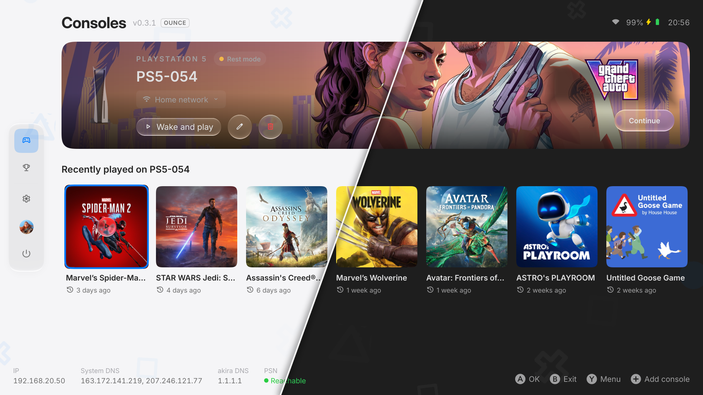
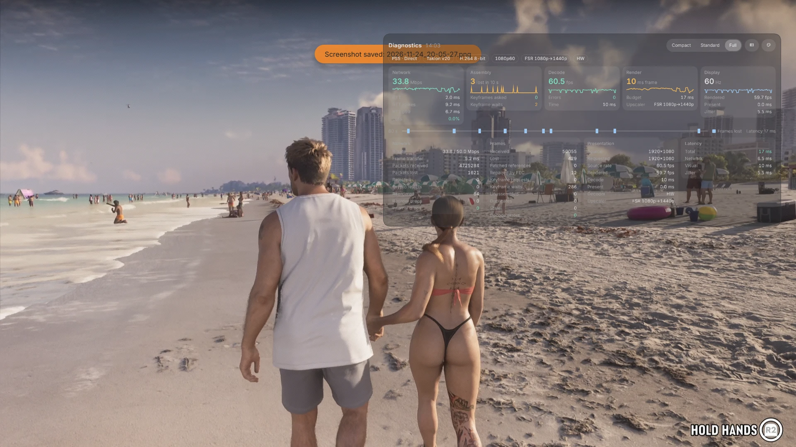
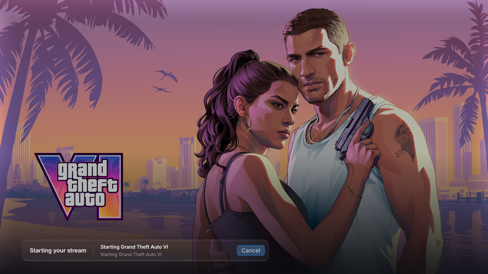
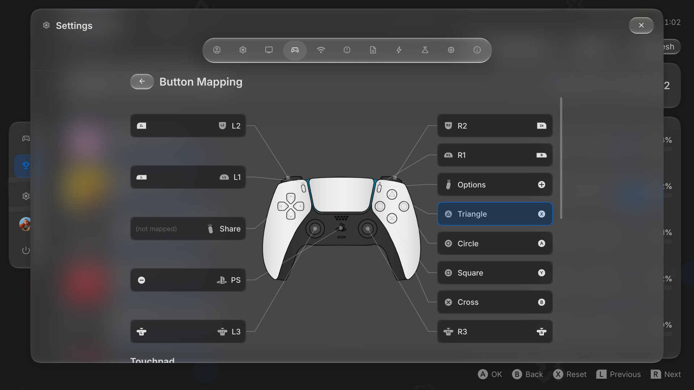
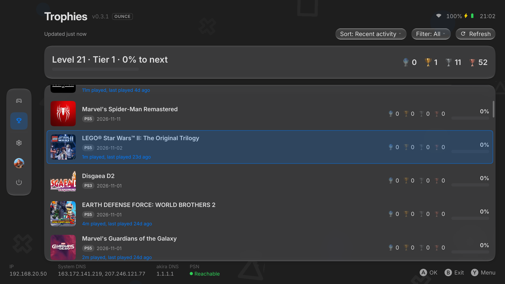

# Akira-ounce
 

## Disclaimer ⚠️

> [!WARNING]  
> **This is an unofficial project that is not endorsed or certified by Sony Interactive Entertainment LLC.**

> [!WARNING]  
> **Please do NOT use this on your switch 2 UNLESS you are able to accept any of the risks and/or disclaimers that the ouncebrew project has mentioned. Switch 2 CFW is in its infancy.**

### You MUST own a PS4/5 to use this. 

  

  
  

  
  

Akira comes with the following features that are carried over from the switch 1 build

- Support for launching directly to a recently played game
- FSR 1.0, with tunable RCAS and dithering values
- Upscale up to 4k (at your own performance penalty)
- PSN Trophy fetching
- Button remapping, touchpad remapping if you're lazy.
- In-game diagnostic menus.
- Hardware h264 decode with SW HEVC decode
- PSN registration by QR code, registration by legacy base64 profile, or via the companion app (to be deprecated)
- Lan discovery / manual discovery

Akira has been tested by Red_Night to run well on fw 13.6 and by me to run well on latest.

If you cannot connect, please drop the takion version and pin it to a lower version.

Additional credits to the following individuals:

- [XITRIX](https://github.com/XITRIX) over from switch 1 moonlight who helped to test this on PS4
- [aveao](https://github.com/aveao) who was helping with getting my env to a testable state.
- [ouncebrew](https://github.com/ouncebrew) for providing a homebrew development environment.
- [ouncebrew](https://github.com/ouncebrew/drako3d) PalindromicBreadLoaf and souldbminer for drako3d, together with the underlying work on deko3d done by finCS
- [uam2](https://github.com/ouncebrew/uam2) uam2, for providing shader compilation

## Issues

Issues are disabled as homebrew users usually turn up to report unreproducible issues which cannot be diagnosed without having a proper conversation, but they don't ever come back to help solve those issues

Please come to discord to chat if you have an issue. The link is above. Please provide logs

---

This software was built with reference/code from:

- [Streetpea](https://github.com/streetpea/chiaki-ng) the original chiaki-ng code
- [Pylux](https://github.com/ForWard-Technologies-LLC/Pylux) for the PS Cloud Streaming implementation
- [moonlight-switch](https://github.com/XITRIX/Moonlight-Switch) XITRIX's deko3d renderer for moonlight for the deko3d bits
- [switchfin](https://github.com/dragonflylee/switchfin/blob/bbcf9037fc3b11a78f5e0b7489d9e776fff2d99c/scripts/switch/mpv/deko3d.patch#L371) The patches used by dragonflylee in switchfin
- [wiliwili](https://github.com/xfangfang/wiliwili) WiliWili for how to get started with this new borealis api.
- [duckstation](https://github.com/RSDuck/duckstation) Duckstation's uam fork for runtime shader compilation

## Credits
- [PS5 icons by Zacksly, please support him here:](https://zacksly.itch.io/ps5-button-icons-and-controls)
- [Switch icons by zacksly, please support him here:](https://itch.io/queue/c/1334295/designs-by-zacksly?game_id=885118&password=)
- [Florian Grill (PXPlay dev](https://streamingdv.github.io/psplay/index.html) for the reverse engineering of the PS Remote Play API
- [Streetpea](https://github.com/streetpea/chiaki-ng) for chiaki-ng and your tireless effort in maintaining this library.
- [moonlight-switch](https://github.com/XITRIX/Moonlight-Switch) for the deko3d rendering code that I based it off with some changes 
- [thestr4ng3r](https://git.sr.ht/~thestr4ng3r/chiaki) for the original chiaki
- [devkitpro](https://github.com/devkitPro) for the associated homebrew packages
- [yellows8](https://github.com/devkitPro/curl/commits/libnx-backend/) for the work on the libnx backend which I used and updated for curl 8.18.0
- [xfangfang](https://github.com/xfangfang), [dragonflylee](https://github.com/dragonflylee), and [XITRIX](https://github.com/XITRIX) for all the work on borealis, moonlight, wiliwili, and switchfin which have made developing homebrew a much smoother experience due to all the examples avaliable.
- [kkwong](https://git.sr.ht/~kkwong/chiaki) for the initial hwacel and rumble patches
- H0neyBadger for the initial switch port, as well as all switch/chiaki contributors especially Egoistically and kkwong
- [QR Code generator](https://github.com/nayuki/QR-Code-generator) by Project Nayuki for the PS Store QR codes, vendored in.
- [micro-ecc](https://github.com/kmackay/micro-ecc) for the ECDH implementation that was vendored in.
- [vecteezy](https://www.vecteezy.com/vector-art/67445984-adorable-capybara-illustration-enjoying-a-drink) for the capybara logo.
